<h1 align="center"></h1>



```zsh
> neofetch
```


```csharp
NurTheDev@github
-------------------------
Name: Nur Islam
Pronouns: He/Him
Location: Dhaka, Bangladesh
Uptime : 22 Years
OS: Arch Linux x86_64
Shell: zsh 5.9
Kernel : Linux
IDE : WebStorm
Expertise: JavaScript, Node.js, Express, React, MongoDB
Hobbies: Cooding, Traveling, Gaming
Favourite Timepass: Doing Nothing
Email: nur756.islam@gmail.com
Linkdin: nurthedev
```


<p align="center">
  <a href="https://nurthedev.is-a.dev"></a>
  <a href="https://www.linkedin.com/in/nurthedev/"></a>
  <a href="mailto:nur756.islam@gmail.com"></a>
</p>

I build MERN apps with real auth and real data, from React interfaces to Express APIs. I'm a junior developer who likes building complete products, not only pages: an e-commerce platform with local payments, a published npm package, and a portfolio designed like an operating system.

**Open to junior full-stack roles and internships, in Dhaka or remote.**

## Projects

<table>
<tr>
<td valign="top" width="50%">

### [Clicon](https://github.com/NurTheDev/clicon)

A full-stack e-commerce platform for Bangladesh. It includes a customer storefront, an admin dashboard, and an Express API with SSLCommerz payments, real-time features through Socket.IO, coupons, invoices, and image uploads.

<sub>React, TypeScript, Tailwind CSS, Node.js, Express, MongoDB</sub>

</td>
<td valign="top" width="50%">

### [nur-create-backend](https://www.npmjs.com/package/nur-create-backend)

A command-line tool that creates an Express and MongoDB backend with one command. It sets up versioned routes, error handling, and sample models. Published on npm.

```bash
npx nur-create-backend my-api
```

<sub>Node.js, Express, Mongoose. [Source code](https://github.com/NurTheDev/create-backend-app-npm)</sub>

</td>
</tr>
<tr>
<td valign="top" width="50%">

### [Nur OS](https://nurthedev.vercel.app)

My portfolio, built as a small desktop you can explore. It has windows, case studies, a résumé, and an assistant that answers questions about me.

<sub>Live on Vercel</sub>

</td>
<td valign="top" width="50%">

### [Exclusive](https://github.com/NurTheDev/Exclusive-e-commerce)

A responsive online store with a product catalog, search, cart, wishlist, reviews, and a dark mode. [Live demo](https://exclusive-stroe.vercel.app/)

<sub>React, Redux Toolkit, Firebase, Tailwind CSS</sub>

</td>
</tr>
</table>

Also worth a look:

- [miniExpress](https://github.com/NurTheDev/miniExpress): an Express-style framework written from scratch, with middleware, routing, and a body parser.
- [BD Screens](https://github.com/NurTheDev/BD-Screens): a streaming web app built with React.
- [students-management](https://github.com/NurTheDev/students-management): a student management project that started from my own nur-create-backend scaffold.

I'm also working on an idea called **Kosai Chai (কসাই চাই)**, a Bengali-language app for booking Qurbani butchers in Dhaka. You can read the case study on my [portfolio](https://nurthedev.vercel.app).

## Stack

<table>
<tr>
<td><b>Frontend</b></td>
<td>


</td>
</tr>
<tr>
<td><b>Backend</b></td>
<td>


</td>
</tr>
<tr>
<td><b>Tools</b></td>
<td>


</td>
</tr>
</table>

Currently learning: PostgreSQL, TypeScript in depth, and advanced React patterns.

## Background

- Head of IT at Diction Coaching
- MERN Stack certification (A+) from Creative IT Institute

## Contact

The fastest way to reach me is call: [+8801957282954] or email: [nur756.islam@gmail.com](mailto:nur756.islam@gmail.com). You can also find me on [LinkedIn](https://www.linkedin.com/in/nurthedev/).

<br clear="both">


